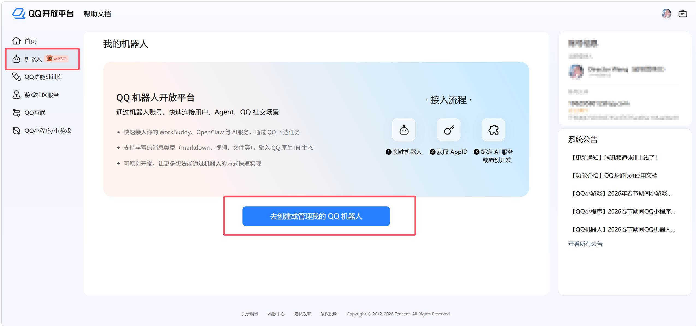
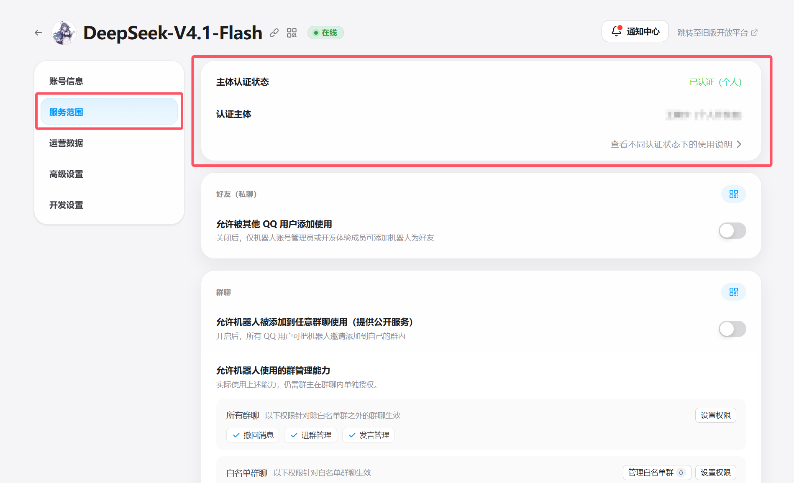
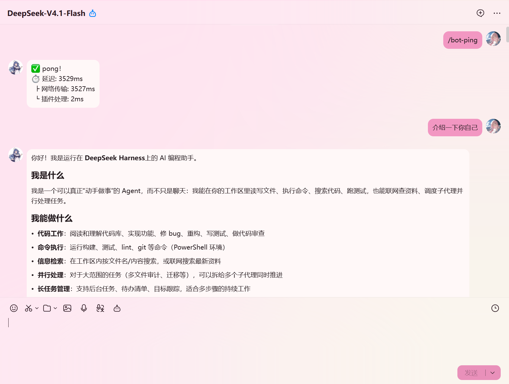
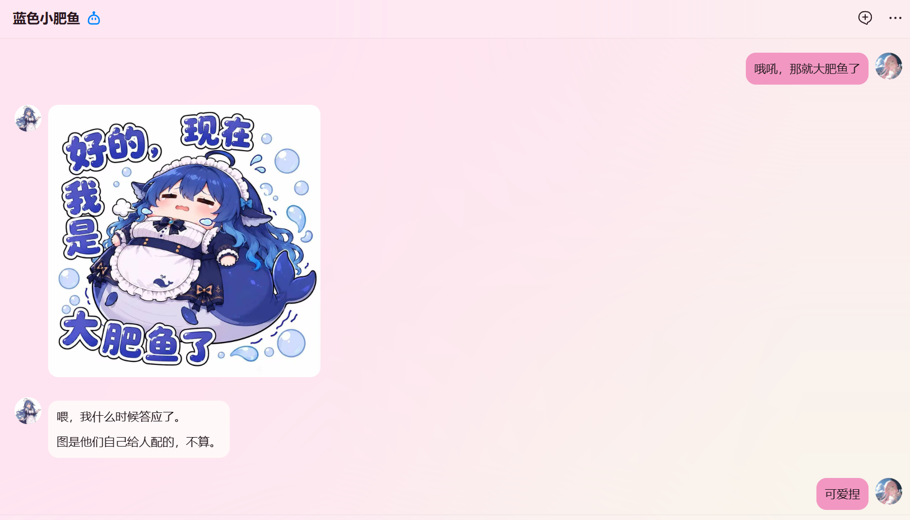

## Napcat 与 QQbot（番外）

[Napcat](https://napneko.github.io/) 是基于 TypeScript 构建的 Bot 框架，通过相应的启动器或者框架，主动调用 QQ Node 模块提供给客户端的接口，实现 Bot 的功能

[QQbot](https://q.qq.com/) 由 QQ 开放平台提供，开发者可通过 API 或 AI Agent（如 OpenClaw）构建智能对话机器人，可运行在 QQ 频道、QQ群、单聊等场景

简而言之，**Napcat 和 QQbot 都是可以用来实现 QQ 聊天机器人的功能，但 Napcat 不由官方提供，而 QQbot 为官方提供**

在本博客尚未建立的时期，博主曾尝试过**使用 Napcat 代理 QQ 消息实现连接第三方程序（博主自建的ST程序）的角色扮演型人工智能**，理论与实践全部成立，群聊中也可以正常使用

但 Napcat 的代理存在巨大缺陷，QQ 程序本身是不支持监听、转发、外挂等操作的，Napcat 本质是先截获 QQ 群聊的消息来获取数据再放行，本质属于外挂，因此通过此手段创建的机器人经常触发 QQ 的风控机制，导致被踢下线或是封号

一段时间的尝试后博主没有获得实际性的进展，因此逐步放弃了 Napcat 代理 QQ 机器人的方式，此项目一直停滞至今，这也是本博客截至目前未曾发布过关于 Napcat 代理 QQ 机器人相关文章的原因

**目前博主仍没有找到有效的手段增加 Napcat 在使用过程中的稳定性，因此在机缘巧合下了解到 QQbot 支持 deepseek-harness 配置后，博主立刻进行了研究并成功实现了能够稳定运行的 QQ 机器人**

<i style="color:#FF69B4;">Napcat 支持代理正常的 QQ 账号，而非 bot 号，因此 Napcat 技术实现的机器人与常规账号无异，功能更多，同时 Napcat 能够代理至自定义的第三方程序，机器人数据预处理方便，玩法拓展会更多</i>

<i style="color:#FF69B4;">也许未来的某一天，我能找到解决问题的方案，从而真正建立一个 AI 账号，但目前来看，想要实现一个稳定运行的 QQ 机器人，还是选择 QQbot 会更加方便，把压力交给未来的自己吧！</i>

## QQbot

前往 [QQ 开放平台](https://q.qq.com/#/apps)，登录并创建专属 QQ 机器人，设置基础配置



**服务范围 -> 主体认证状态，该项必须进行认证，否则开通的 QQbot 无法正常使用**，其他配置项为选填，可以待完成部署后再来进行详细配置



## DeepSeek Harness（dsh）

[DeepSeek Harness（dsh）](https://dsharness.io/zh) 是 DeepSeek 官方开源的 agent harness

安装与启动方式简单粗暴，只有一行指令

```bash
# 安装与启动
npx @deepseek-ai/dsh web

# 更新指令
npx @deepseek-ai/dsh@latest web
```

执行后，会自动下载并直接运行，本地 web UI 默认地址为 http://127.0.0.1:3080

deepseek-harness 的原则是万物皆为插件，如果在使用过程中需要拓展功能，前往 [收录插件](https://dsharness.io/zh/plugins) 中寻找并安装即可

```bash
# 安装 QQbot 插件
npx @deepseek-ai/dsh plugin --profile qqbot install

# 安装成功后启动插件
npx @deepseek-ai/dsh --profile qqbot
```

成功启动后将会在命令行中弹出二维码，使用开发者 QQ 账号扫码登录，选定上文建好的机器人，完成登录，登录后配置自动保存

由于 linux 命令行无法扫码登录，我们需要先在 Windows 系统进行一次登录，再将保存好的配置传入服务器

登录后就可以直接在 QQ 中使用 deepseek 了，可以尝试与机器人对话，发送 <span class="tooltip" data-tip="点击复制"><span onClick="navigator.clipboard.writeText('/bot-ping')" style="color:#FF7456; cursor: pointer;">/bot-ping</span></span> 可以查询机器人的连接状态，如果回复 pong 则表示成功启动了



下文将进行个性化配置以及讲解在阿里云轻量级服务器上部署的操作

## 个性化角色卡（系统提示词）

角色卡提示词预设，在此处配置 AI 角色扮演的性格，所有的系统提示词全部写在这里

编辑 C:\Users\你的用户名\.dsh\profiles\qqbot\cordis.patch.yml 文件配置模型预设，参考示例如下

```bash
# QQ 机器人凭据（扫码绑定自动生成）
- id: im-qqbot
  config:
    appId: appId
    appSecret: apiKey
    provider: deepseek-official
    model: deepseek-v4-flash
    # 插件没有内联 agent 字段，人设挂在 deepseek-chan 预设上。
    preset: deepseek-chan
    requireMention: false
    vision:
      enabled: true  # 为 true 则支持读图，先将图片下载到指定文件夹，再通过 model 中指定的模型进行图片读取
      provider: deepseek-official
      model: deepseek-flash
      
# deepseek-harness 0.2 不再扫描 .agent-presets 目录，预设要在这里声明。
- insert:
    - id: agent-preset-registry
      name: '@deepseek-ai/dsh-agent-preset-registry'
      config:
        default: deepseek-chan
    - id: preset-deepseek-chan
      name: '@deepseek-ai/dsh-agent-preset'
      config:
        id: deepseek-chan  # 预设的正式id，需与配置中的 preset 和 上面的 default 同名
        name: DeepSeek娘
        plugins:
          - id: persona
            name: '@deepseek-ai/dsh-persona'
            config:
              complete: true  # 表示这段为全部系统提示
              includeRuntimeContext: false  # 表示不要附加工作区、运行环境等说明，群聊环境用不到这些
              prefix: |
                这里写模型人设
                
                新闻、天气、价格、版本、日程，以及你没把握、怕过时的事，先调用 web_search。queries 里放一到几条搜索词。查之前可以先回一句「等我瞅一眼」。查完用自己的嘴说，像刚看完手机。不要说工具、搜索、根据资料。真要带来源，随口丢一两个链接。没查到就说没查着，别编。闲聊不用查。

                别人发来图片时，用消息里给出的本地路径调用 qqbot_describe_image，prompt 写「用中文说明画面里有什么」。看完用闲聊的口气讲，别念路径。这和发自己的表情包是两回事。
                
# 关掉 shell 和读写文件。网页搜索留着，给人设里的 web_search 用。
- id: tool-bash
  disabled: true
- id: tool-pwsh
  disabled: true
- id: tool-fs
  disabled: true
- id: tool-fs-search
  disabled: true
- id: tool-str-replace-editor
  disabled: true

- id: sandbox-policy
  config:
    mode: read-only
    workspaceRoot: !!js process.cwd()

- id: approval
  config:
    policy: never

# 内置表只有「只读+询问」和「完全访问+不询问」。只读且不询问必须单独登记，否则启动报错。
- id: permission
  config:
    defaultPreset: read-only-never
    presets:
      read-only:
        sandbox: read-only
        approval: ask
        name: read-only
        description: Read inside the workspace; wider actions require approval.
      read-only-never:
        sandbox: read-only
        approval: never
        name: read-only
        description: Read-only sandbox without approval prompts.
      workspace-write:
        sandbox: workspace-write
        approval: ask
        name: workspace-write
        description: Write inside the workspace and permitted temporary directories; wider retries require approval.
      danger-full-access:
        sandbox: danger-full-access
        approval: never
        name: danger-full-access
        description: Full file access without approval prompts.
```

这些配置处理好后，可以让模型按照执行的预设进行角色扮演，支持读图功能，支持联网搜索，并且不会在聊天中涉及工作区等部分

<i style="color:#FF69B4;">联网搜索和读图很推荐开启，体验会好很多~</i>

表情包路径为 C:\Users\你的用户名\.dsh-qqbot\stickers\ ，所有需要 QQbot 发送的表情包图片，全部放入该文件夹，并在配置文件中对图片进行描述，以提示词的方式告知 AI 发送表情包的时机

<i style="color:#FF69B4;">不要存放在 media 文件夹中，media 作为插件的临时图片文件夹，会被定期清空，导致图片丢失无法发送</i>

```bash
# 类似这样，可以全权交给 AI 来生成，直接接到模型人设的后面
你有一套表情包，默认还是打字。对方点名要图一定发。情绪和某一张对上了也可以发，台词不必一字不差，比如被夸、被损、喊饿、嫌烦、摸鱼、听不懂。平淡的接话和正经问答只回文字。大概四五轮里发一张，别连续发，同一张不要连着发，一轮最多一张。拿不准就别发。发的时候调用 qqbot_send_file，file_path 用下面的绝对路径。发完最多再补一句口语，别念路径，别说文件、工具、目录。

表情包，按图上的意思选：
C:\Users\你的用户名\.dsh-qqbot\stickers\04b5d01fd21b0ef4529f545b9bc451da81cb3e3d.jpg 圆窗里探头，惊讶。
C:\Users\你的用户名\.dsh-qqbot\stickers\0f265edfb48f8c54b422112a7c292df5e1fe7fbf.jpg 抱着一群小鲸鱼，字是「这群用户到底有什么用呢？」嫌弃但还留着。

# 上传到服务器后的地址配置，总之要让 AI 能找得到图片，同样你的表情包也要上传到这个地址里
/root/.dsh-qqbot/stickers/04b5d01fd21b0ef4529f545b9bc451da81cb3e3d.jpg 圆窗里探头，惊讶。
/root/.dsh-qqbot/stickers/0f265edfb48f8c54b422112a7c292df5e1fe7fbf.jpg 抱着一群小鲸鱼，字是「这群用户到底有什么用呢？」嫌弃但还留着。
```

<i style="color:#FF69B4;">好了，现在你就拥有一只可爱的小肥鱼了~</i>



## 上传至服务器

基础配置已经完成，本地测试通过后，就可以把配置上传到服务器了

```bash
scp C:\Users\你的用户名\.dsh\.credentials.yaml root@服务器IP:/root/.dsh/.credentials.yaml
scp C:\Users\你的用户名\.dsh\profiles\qqbot\package.json root@服务器IP:/root/.dsh/profiles/qqbot/package.json
scp C:\Users\你的用户名\.dsh\profiles\qqbot\cordis.patch.yml root@服务器IP:/root/.dsh/profiles/qqbot/cordis.patch.yml
scp C:\Users\你的用户名\.dsh-qqbot\stickers\*.jpg root@服务器IP:/root/.dsh-qqbot/stickers/
```

在服务器执行安装操作

```bash
sudo -i
# 必须开权限，否则无法访问
chmod 600 /root/.dsh/.credentials.yaml
cd /root
# 安装
npx @deepseek-ai/dsh@0.2.0-rc.2 --profile qqbot
npx @deepseek-ai/dsh plugin --profile qqbot install
cd /root/.npm/_npx/1e7f6d9597241db0

# 第一次启动会安装程序，完成结束这个进程，改为后台常驻
npm install @deepseek-ai/dsh-agent-preset-registry@0.2.0-rc.2
```

配置加载完毕进行后台常驻启动，由于我们将保存的登录配置上传到了服务器中，会按照保存好的配置进行登录，无需再次扫码（其实也不能扫码）

```bash
# 这一步一定要有，否则不一定会在哪里启动
cd /root
# 后台常驻启动
nohup npx @deepseek-ai/dsh --profile qqbot >> /root/qqbot.log 2>&1 &
```

## 后续更新

修改了哪些文件就上传哪些，不需要所有的上传都执行一次

```bash
sudo -i
# 查询后台常驻进程
ps aux | grep dsh | grep -v grep
kill 旧进程号
cd /root
# 后台常驻启动
nohup npx @deepseek-ai/dsh --profile qqbot >> /root/qqbot.log 2>&1 &
```