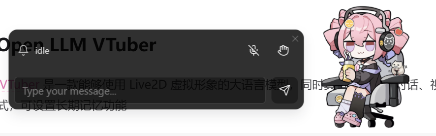
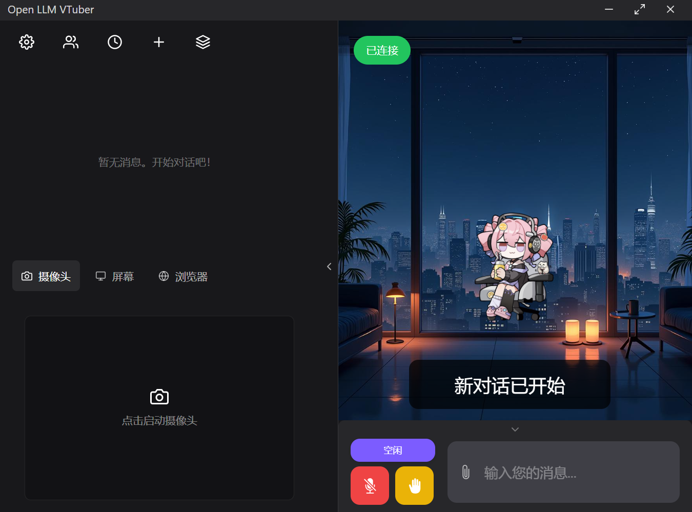
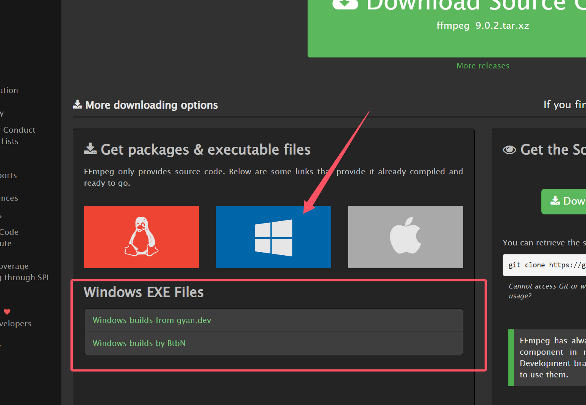
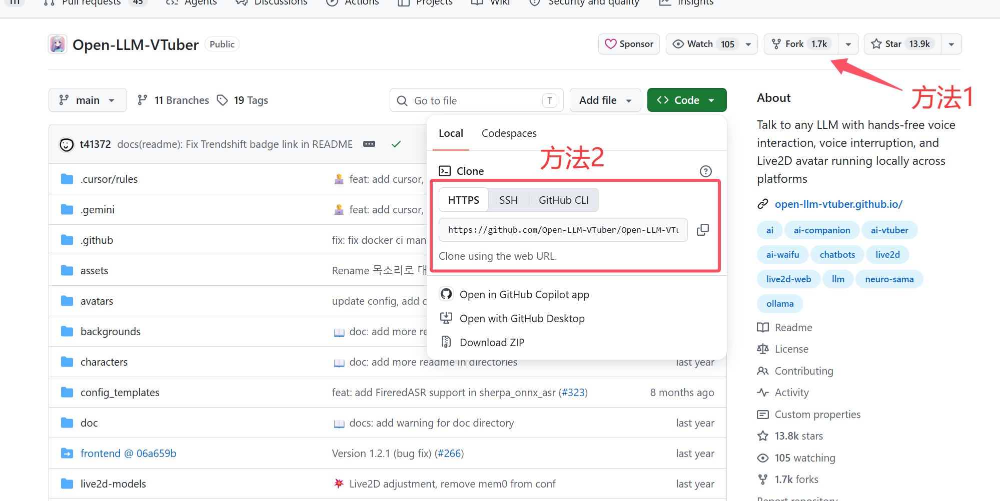

## 什么是 Open LLM VTuber

在开始部署 Open LLM VTuber 之前，我们必须了解它能够做些什么事情

[Open LLM VTuber](https://docs.llmvtuber.com/) 是一款能够使用 Live2D 虚拟形象及大语言模型进行实时对话的开源语音交互 AI 伴侣

**Open LLM VTuber 的能力**
- 实时语音对话
- 视频感知
- 桌宠模式
- 长期记忆
- 支持自定义 Live2D 模型
- 离线与在线双模式
- 模块化设计提供良好的拓展性





## 安装 Open LLM VTuber 及其相关环境

Open LLM VTuber 官方提供的安装教程十分详细，可以直接参考官方文档中的 [快速开始](https://docs.llmvtuber.com/docs/quick-start) 进行安装

**下文将简要总结安装步骤以及注意事项**

### 安装 git 与 FFmpeg

git 用于 github 拉取项目代码，FFmpeg 用于处理音视频文件，是必须安装的依赖

> [!IMPORTANT] 重要
> **关于 winget**
> 
> 如果你的 Windows 版本较旧 (Windows 11 (21H2 之前))，你的电脑可能没有内置 winget 包管理器。你可以去微软应用商店中搜索并下载 winget。
> 
> 如果使用 Windows 10 1809 (build 17763) 之前的版本，你的电脑可能不支持 winget。请前往 Git 官网下载 git 安装包进行安装。之后的 ffmpeg 也请自行上网搜索 ffmpeg 的安装指南。

```bash
# 在命令行中使用 winget 安装 git
winget install Git.Git
```

如果没有 winget ，点击 [git](https://git-scm.com/install/windows) 下载并安装

```bash
# 在命令行中使用 winget 安装 ffmpeg
winget install ffmpeg
```

同上，如果没有 winget ，点击 [FFmpeg](https://ffmpeg.org/download.html) 下载并安装，注意请选择下方的 Windows EXE Files 进行下载



### 安装 Python

```bash
# 方法 1: PowerShell 安装
powershell -ExecutionPolicy ByPass -c "irm https://astral.sh/uv/install.ps1 | iex"

# 方法 2: winget 安装
winget install --id=astral-sh.uv -e
```

### 获取 Open LLM VTuber 项目代码

获取 [Open LLM VTuber](https://github.com/Open-LLM-VTuber/Open-LLM-VTuber) 项目代码（此链接与下方一致）

::github{repo="Open-LLM-VTuber/Open-LLM-VTuber"}



**方法一：**

点击 Fork 将仓库复制到自己的账号下，使用 HTTPS 或 SSH 拉取，**此方法方便后续对代码进行修改等操作，如无需魔改则直接使用方法二即可**

**方法二：**

直接在原仓库使用 HTTPS 方式拉取

**无论是方法一还是方法二，拉取的方式都是复制地址然后在命令行中执行**

```bash
# 在你准备好的文件夹中打开命令行
git clone 你复制的 HTTPS 或 SSH 地址
```

### 安装 ASR（视情况）

> [!IMPORTANT] 重要
> **官方描述为自动安装，博主实测并非如此，可以选择跳过此步骤，后续出现问题时再返回进行安装**

安装 ASR （语音识别）模块，此模块据说在运行项目初始化时会自动下载，但博主经历了两次部署，ASR 都出现了未下载的问题，此处建议手动安装

点击 [sherpa-onnx-sense-voice-zh-en-ja-ko-yue-2024-07-17.tar.bz2](https://github.com/k2-fsa/sherpa-onnx/releases/download/asr-models/sherpa-onnx-sense-voice-zh-en-ja-ko-yue-2024-07-17.tar.bz2) 下载，需保持与 github 连接无异常

下载后将下载好的文件放入路径为 **Open-LLM-VTuber/models/** 的文件夹，运行时将会自动初始化解析（没有models文件夹的话自己创建一个）

### 安装依赖并配置环境

```bash
# 进入获取到的项目目录
# 安装项目依赖
uv sync

# 运行主程序生成预设的配置文件，首次启动时需下载资源，等待时间可能会稍久一些
# 后续的启动命令与此一致
uv run run_server.py
```

如果想要使用桌面端或桌宠模式，需要额外下载 [open LLM VTuber 客户端](https://github.com/Open-LLM-VTuber/Open-LLM-VTuber-Web/releases) ，在后端代码运行时启动客户端即可使用

初始化结束后，项目自动启动，加载完成后弹出网页

如需使用桌面端，保留命令行不要退出程序，直接打开下载好的桌面端应用即可连接

**至此 Open LLM VTuber 安装完毕，后续将进行 Ollama 和 GPT-SoVITS 的部署及配置**

**Ollama （用于本地部署大模型）将会作为本地运行的 LLM 参与到对话当中，而 GPT-SoVITS （用于语音合成训练（TTS））将会提供 TTS 服务，并且可以实现定制化的语音合成功能**

## 安装 Ollama

安装 [Ollama](https://ollama.com/)，用于本地部署大语言模型

*如果不希望本地部署可以前往 [语言模型 LLM](https://docs.llmvtuber.com/docs/user-guide/backend/llm) 参考如何使用线上API*

```bash
# 命令行执行，打开 Ollama
ollama

# 运行/下载本地模型，下载时请务必查看模型的参数，确保自己的配置可以运行
ollama run 希望安装的模型
# 示例，安装 gemma4:e2b 模型
ollama run gemma4:e2b
```
挑选模型时请务必确保你的显卡配置可以舒适运行你所选择的模型，由于要给其他功能留出空间，请不要选择运行时会将显存占满的模型

显卡型号与运行模型的实际显存占用参考
- 笔记本4060显卡 运行qwen2.5:latest 7B参数 显存占用6-7GB
- 台式机5070Ti显卡 运行gemma:7b 9B 参数 显存占用10-11GB

Ollama 安装完成，回到 Open LLM VTuber 的文件夹中，找到 conf.yaml 配置文件

找到 **LLM 后端设置** ，修改当中 **ollama llm** 的配置

```yaml
ollama_llm:
  base_url: 'http://localhost:11434/v1' # 基础 URL
  model: 'gemma4:e2b' # 使用的模型，如果 ollama 安装的是 gemma4:e2b ，那这里就填写 gemma4:e2b
  temperature: 0.7 # 温度，介于 0 到 2 之间
  # 不活动后模型在内存中保留的时间（秒）
  # 设置为 -1 表示模型将永远保留在内存中（即使退出 open llm vtuber 之后也是）
  keep_alive: -1
  unload_at_exit: True # 退出时从内存中卸载模型
```

**model 的值必须与在 Ollama 上安装的模型名完全一致，否则识别不到**

配置修改完毕后，再次启动 Open LLM VTuber 就会切换为 Ollama 中本地部署的模型了

## 安装 GPT-SoVITS

GPT-SoVITS 是一款开源 AI 语音克隆与文本转语音（TTS）工具，仅需 5 秒语音样本即可克隆任意声音，且完全开源、可本地部署

这里采用 GPT-SoVITS 来作为 Open LLM VTuber 的 TTS 工具

魔塔社区下载链接
- [GPT-SoVITS-1007-cu124](https://www.modelscope.cn/models/aihobbyist/GPT-SoVITS-Inference/file/view/master/GPT-SoVITS-1007-cu124.7z) 非50系显卡
- [GPT-SoVITS-1007-cu128](https://www.modelscope.cn/models/aihobbyist/GPT-SoVITS-Inference/file/view/master/GPT-SoVITS-1007-cu128.7z) 50系显卡

两个版本内置的CUDA版本不同，12.4版本适用非50系显卡，12.8版本适用50系显卡

<i style="color:#FF69B4;">下载前一定要确认自己下载的是对应版本！我在这里踩过大坑（哭）</i>

安装好程序后，就需要获取语音模型了

这里推荐 [AI Hobbyist资源库](https://res.acgnai.top/tts) 进行 TTS 的模型资源下载，其中包含多款市面上较火的二游角色语音模型

<i style="color:#FF69B4;">如果没有你想要的语音模型，GPT-SoVITS 也支持自主训练语音模型，训练方式与注意事项将在后续其他文章中单独整理</i>

获取语音模型后，将 **.ckpt** 后缀文件放入 **GPT_weights_v4** 文件夹中，将 **.pth** 后缀文件放入 **SoVITS_weights_v4** 文件夹中

运行 **go-webui.bat** 文件，自动安装依赖并且启动项目

在项目文件夹下，找到 **configs** 文件夹（没有就新建一个），创建配置文件 **tts_infer.yaml** ，复制下方内容到其中，用于启动项目

```yaml
custom:
  bert_base_path: GPT_SoVITS/pretrained_models/chinese-roberta-wwm-ext-large
  cnhuhbert_base_path: GPT_SoVITS/pretrained_models/chinese-hubert-base
  device: cuda
  is_half: true
  t2s_weights_path: "GPT_weights_v4/你的模型名称.ckpt"
  version: v4
  vits_weights_path: "SoVITS_weights_v4/你的模型名称.pth"
v1:
  bert_base_path: GPT_SoVITS/pretrained_models/chinese-roberta-wwm-ext-large
  cnhuhbert_base_path: GPT_SoVITS/pretrained_models/chinese-hubert-base
  device: cpu
  is_half: false
  t2s_weights_path: GPT_SoVITS/pretrained_models/s1bert25hz-2kh-longer-epoch=68e-step=50232.ckpt
  version: v1
  vits_weights_path: GPT_SoVITS/pretrained_models/s2G488k.pth
v2:
  bert_base_path: GPT_SoVITS/pretrained_models/chinese-roberta-wwm-ext-large
  cnhuhbert_base_path: GPT_SoVITS/pretrained_models/chinese-hubert-base
  device: cpu
  is_half: false
  t2s_weights_path: GPT_SoVITS/pretrained_models/gsv-v2final-pretrained/s1bert25hz-5kh-longer-epoch=12-step=369668.ckpt
  version: v2
  vits_weights_path: GPT_SoVITS/pretrained_models/gsv-v2final-pretrained/s2G2333k.pth
v2Pro:
  bert_base_path: GPT_SoVITS/pretrained_models/chinese-roberta-wwm-ext-large
  cnhuhbert_base_path: GPT_SoVITS/pretrained_models/chinese-hubert-base
  device: cpu
  is_half: false
  t2s_weights_path: GPT_SoVITS/pretrained_models/s1v3.ckpt
  version: v2Pro
  vits_weights_path: GPT_SoVITS/pretrained_models/v2Pro/s2Gv2Pro.pth
v2ProPlus:
  bert_base_path: GPT_SoVITS/pretrained_models/chinese-roberta-wwm-ext-large
  cnhuhbert_base_path: GPT_SoVITS/pretrained_models/chinese-hubert-base
  device: cpu
  is_half: false
  t2s_weights_path: GPT_SoVITS/pretrained_models/s1v3.ckpt
  version: v2ProPlus
  vits_weights_path: GPT_SoVITS/pretrained_models/v2Pro/s2Gv2ProPlus.pth
v3:
  bert_base_path: GPT_SoVITS/pretrained_models/chinese-roberta-wwm-ext-large
  cnhuhbert_base_path: GPT_SoVITS/pretrained_models/chinese-hubert-base
  device: cpu
  is_half: false
  t2s_weights_path: GPT_SoVITS/pretrained_models/s1v3.ckpt
  version: v3
  vits_weights_path: GPT_SoVITS/pretrained_models/s2Gv3.pth
v4:
  bert_base_path: GPT_SoVITS/pretrained_models/chinese-roberta-wwm-ext-large
  cnhuhbert_base_path: GPT_SoVITS/pretrained_models/chinese-hubert-base
  device: cpu
  is_half: false
  t2s_weights_path: GPT_SoVITS/pretrained_models/s1v3.ckpt
  version: v4
  vits_weights_path: GPT_SoVITS/pretrained_models/gsv-v4-pretrained/s2Gv4.pth
```

记得将**第六行**与**第八行**的模型名称替换为你下载好的模型，否则启动时会找不到文件

```bash
# 启动命令，使用刚刚写入的配置文件启动，切换默认的语音模型
runtime\python.exe -I api_v2.py -a 127.0.0.1 -p 9880 -c configs/tts_infer.yaml
```

启动成功后，返回 Open LLM VTuber 文件夹，打开 **conf.yaml** 文件，修改当中 **文本转语音** 的配置

```yaml
# tts_model 的配置对应修改为 gpt_sovits_tts ，将生效 gpt_sovits_tts 的配置，代替项目本身的 tts 功能
tts_config:
    tts_model: 'gpt_sovits_tts' # 使用的文本转语音模型

# 找到 gpt_sovits_tts 模块的配置，进行修改
gpt_sovits_tts:
  # 将参考音频放到 GPT-Sovits 的根路径，或在此处设置路径
  api_url: 'http://127.0.0.1:9880/tts' # API URL
  text_lang: 'zh' # 文本语言
  ref_audio_path: '***' # str.(必需) 参考音频的路径（一般存在同级目录下）
  prompt_lang: 'zh' # str.(必需) 参考音频提示文本的语言
  prompt_text: '***' # str.(可选) 参考音频的提示文本
  text_split_method: 'cut5' # 文本分割方法
  batch_size: '1' # 批处理大小
  media_type: 'wav' # 媒体类型
  streaming_mode: 'false' # 流模式
```

## Open LLM VTuber

以上工具及配置处理好后，你已经获得了一个可以自选本地模型，自定义音色语音转换的 AI 聊天系统了

在项目根目录使用以下指令启动 Open LLM VTuber

```bash
uv run run_server.py
```

成功启动后打开弹出的网页，就可以使用网页版的聊天系统了，也可以打开 Open LLM VTuber 的客户端程序，会检测并连接到刚刚启动的后端代码

至此，将会获得本文最初的展示效果，具体功能就待各位自行探索吧

另外，运行时需要时刻关注显存，如果专用显存溢出，可以切换参数较少的模型来缓解性能压力

<i style="color:#FF69B4;">Open LLM VTuber 可以改装的部分还挺多的，目前仅整理了修改本地模型与语音合成的部分，后续还会整理配置 live2D 与训练 TTS 模型的文章</i>

<i style="color:#FF69B4;">我电脑的配置较低，因此下一步会尝试转用线上 API 来进行对话处理，考虑直接对接我已有的酒馆项目，降低性能消耗</i>
